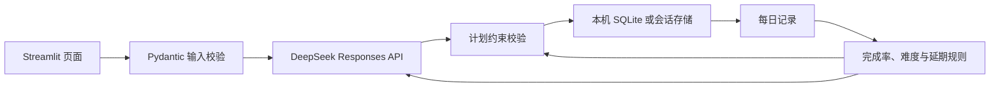

# 学习罗盘架构

## 桌面版 2026.10.5

- PySide6主窗口与全局、无owner的独立指南窗口；同一Markdown同时用于离线指南和随包说明。指南导入Markdown后应用实际Qt文本块排版。
- `WeekPanel`把同一组筛选后的稳定任务ID呈现为七日周历或明细表；预计与累计实际用时按任务归属统计，不虚构小时排期或统一容量。
- 任务入口调用同一专注计时器，切换前确认并提交旧记录；不会按任务时长重置设置或自动标记完成。
- `ModelGateway`固定配置快照，经可取消的异步传输完成真实SDK请求；默认/直连路由显式选择，TLS使用系统及公共根，显式CA设置覆盖默认策略。诊断只保存白名单字段，不保存Key或原始异常正文。
- SQLite schema3为草稿独立保留创建时间；语义不变的保存不更新时间，旧创建时间留空。旧库/恢复均先复制、备份、迁移校验后原子替换。

## 数据流

## 两种运行模式

- **local**：计划、进度、复盘、无原始提示词的调用指标保存在本机 SQLite。每份计划有独立 ID。
- **demo**：每个浏览器会话有独立样例和记录。样例复盘只用确定性规则；真实生成必须先通过邀请码与共享数据库的每日额度检查。公开应用不会从本机 SQLite 读取其他人的计划。

## 重要约束

1. 原始计划必须与用户输入的周数、每周天数、单日分钟数匹配。
2. 每周复盘前，本周所有任务要有“已完成”或“延期”的最终状态；已复盘周次不能修改。
3. 后续计划只替换未开始的周次，延期任务确定性地放入下一周前面。
4. 任何模型结果在保存前再次通过 Pydantic 和时间上限校验。
5. 真实密钥只从运行环境读取，不存入计划、导出文件、评测报告或 Git。

## 当前边界

- 公开样例记录属于当前会话；使用 JSON 下载和导入跨会话继续。
- 评测框架提供 30 组固定输入与人工评分表；真实模型表现需运行评测后才能填写。
- 公开样例已部署在 [Streamlit Community Cloud](https://ai-learning-compass-g4awbdngukgkydhe5rzcnp.streamlit.app/)；未配置云端 Secrets，因此不开放付费真实生成。代码本身不含这些凭据。
